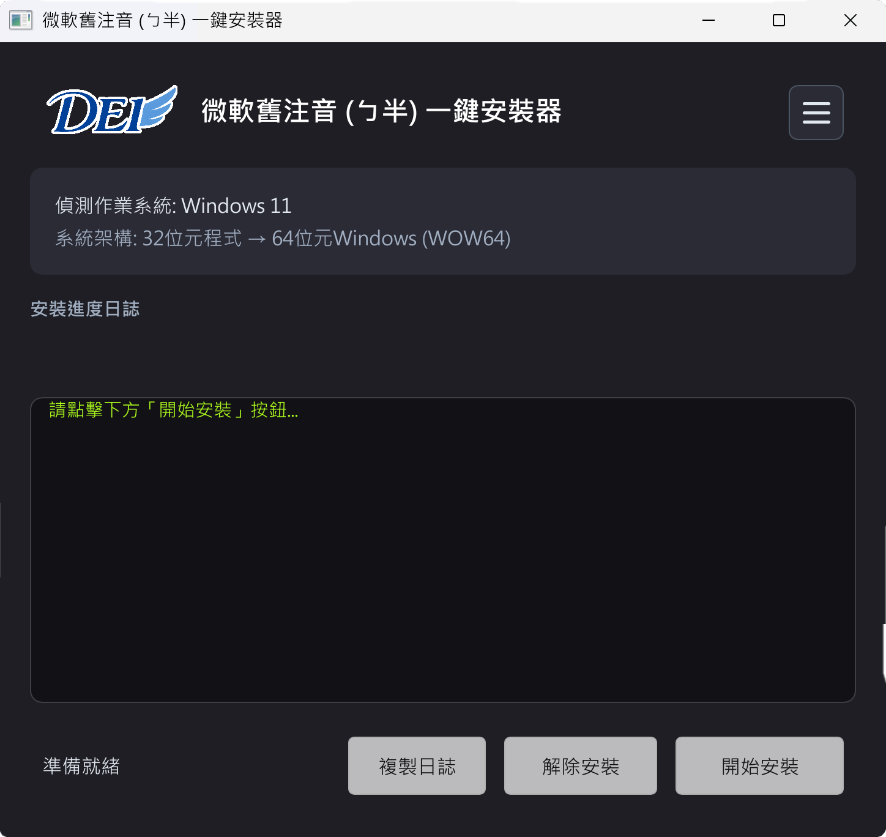



  

[繁體中文](../../README.md) · **English** · [简体中文](README_zh-CN.md)

# Microsoft Legacy Bopomofo (ㄅ半) 1-Click Free Installer

### Native 1-Click Installation, Automatic TSF Repair, and Restore Utility for Windows 10 & 11
Get back the deterministic, rapid typing experience of classic Bopomofo (ㄅ半) on modern Windows without missing candidate windows or registry headaches!

[Overview](#-overview) · [Key Features](#-key-features) · [Screenshots](#-screenshots) · [Download & Usage](#-download--usage) · [System Requirements](#-system-requirements) · [FAQ](#-frequently-asked-questions-faq) · [Support](#-support--feedback)

---

## 📖 Overview

For decades, **Microsoft Legacy Bopomofo (ㄅ半, Phonetic IME)** has been the go-to input method for millions of Traditional Chinese typists, software engineers, and administrative professionals who demand deterministic character matching without unwanted predictive auto-corrections.

However, starting from **Windows 10** and **Windows 11**:
1. Microsoft removed the legacy Bopomofo option from standard language settings.
2. Manually importing registry keys often breaks after system updates, leading to missing candidate popup windows, lack of composition underlines, or broken input in modern apps (such as new Notepad, Office 365, Edge, and Chrome).
3. Manual configuration is complex and risky for system language profiles.

**Microsoft Legacy Bopomofo (ㄅ半) 1-Click Free Installer** is built in pure Rust and the modern Slint GUI framework by DEI Tech (得翼科技). It automatically detects your operating system architecture, fully configures registry settings (including critical Tsf3Override keys and TSF TIP registration), invokes native Windows APIs (InstallLayoutOrTip), and restarts the language service (ctfmon.exe). **No reboot required—enjoy classic Bopomofo immediately with just one click!**

---

## ✨ Key Features

### 1. ⚡ 1-Click Automated Express Installation
- Automatically detects Windows version (Win 11 / 10 / 8.1 / 8 / 7) and CPU architecture (x64 / x86).
- Registers essential Tsf3Override and TSF TIP registry entries for full compatibility with modern Windows apps.
- Calls native InstallLayoutOrTip and restarts ctfmon.exe—ready to use in 1 to 3 seconds with zero system restarts.

### 2. 🔄 1-Click Clean Uninstallation
- Allows instant and complete removal whenever needed. Cleans up all injected registry entries without leftover debris.

### 3. 📋 Real-Time Progress Log with 1-Click Copy
- Features an embedded, visual installation progress log displaying each system call step.
- Provides a one-click copy button for quick diagnostics and support.

### 4. 🔒 100% Offline & Pure Privacy
- Runs completely offline without any internet communication or telemetry.
- Strictly never logs keystrokes, personal data, or system telemetry.
- Packaged as a standalone 32-bit universal PE binary without external dependencies (.NET or VC++ runtimes NOT required).

---

## 📸 Screenshots

  

---

## 📦 Download & Usage

### 📥 Download
1. Head over to the [Releases page](https://github.com/robert820/winxp-bopomofo-installer/releases) and download 微軟舊注音 (ㄅ半) 一鍵免費安裝器.exe.
2. This is a single portable executable file. No installation wizard required.

### 🚀 Usage Guide
1. **Run as Administrator**: Right-click the .exe file and select "Run as administrator" to grant necessary permissions for registry and input method services.
2. **Click "開始安裝" (Start Installation)**: The program automatically handles system detection, registry injection, and service reloading.
3. **Switch & Type**: Once completed, switch to "微軟舊注音 (ㄅ半)" using Ctrl + Shift or Win + Space to start typing!

---

## 🖥️ System Requirements

- **Operating System**: Windows 11 / 10 / 8.1 / 8 / 7 (SP1)
- **Architecture**: 64-bit (x64) and 32-bit (x86)
- **Privilege**: Administrator privileges required for system registry modification
- **Dependencies**: None (self-contained native binary)

---

## ❓ Frequently Asked Questions (FAQ)

<b>Q1: Why does typing in certain modern apps (like new Notepad or Office) still fail after installation?</b>

A: The installer automatically configures Microsoft TSF (Text Services Framework) compatibility keys and Tsf3Override. If a specific application was already running during installation, please restart that application (or restart your computer once) so that all background input contexts reload properly.

<b>Q2: Is this tool free? Can computer repair technicians use it?</b>

A: Yes! It is completely free for individuals, enterprises, and computer repair workshops. You may freely include it on maintenance USB drives. However, reselling or bundling for commercial profit is strictly prohibited.

<b>Q3: Why does antivirus or Windows SmartScreen trigger a warning?</b>

A: This tool is written in Rust and is 100% clean of malware. Because registering system-level input methods requires modifying Windows registry keys and restarting ctfmon.exe, some heuristic detection engines may flag it. Please feel free to allow execution or add to trusted exclusions.

---

## 💬 Support & Feedback

- 🐛 **Issue Tracker**: Submit bug reports and feature requests via [GitHub Issues](https://github.com/robert820/winxp-bopomofo-installer/issues).
- 🌐 **Official Website**: [https://blog.dei3c.com](https://blog.dei3c.com)

---

## 📄 License

This software is released under a Proprietary Freeware License. For full terms, conditions, and disclaimers, please see the [LICENSE](../../LICENSE) file.
